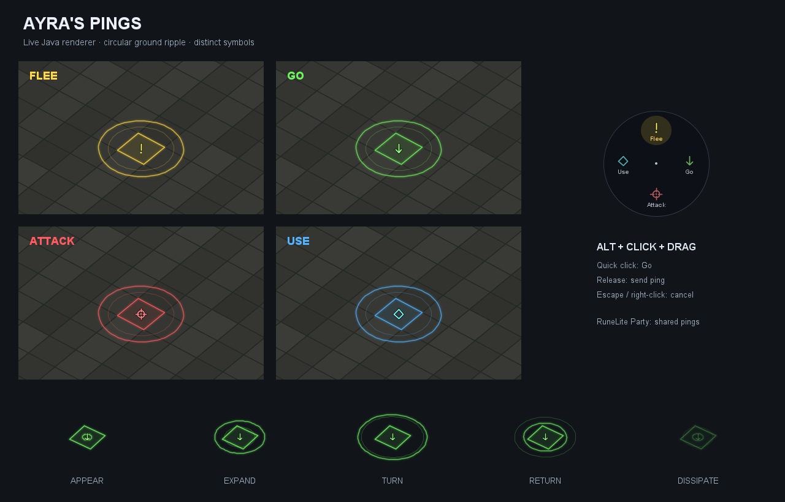
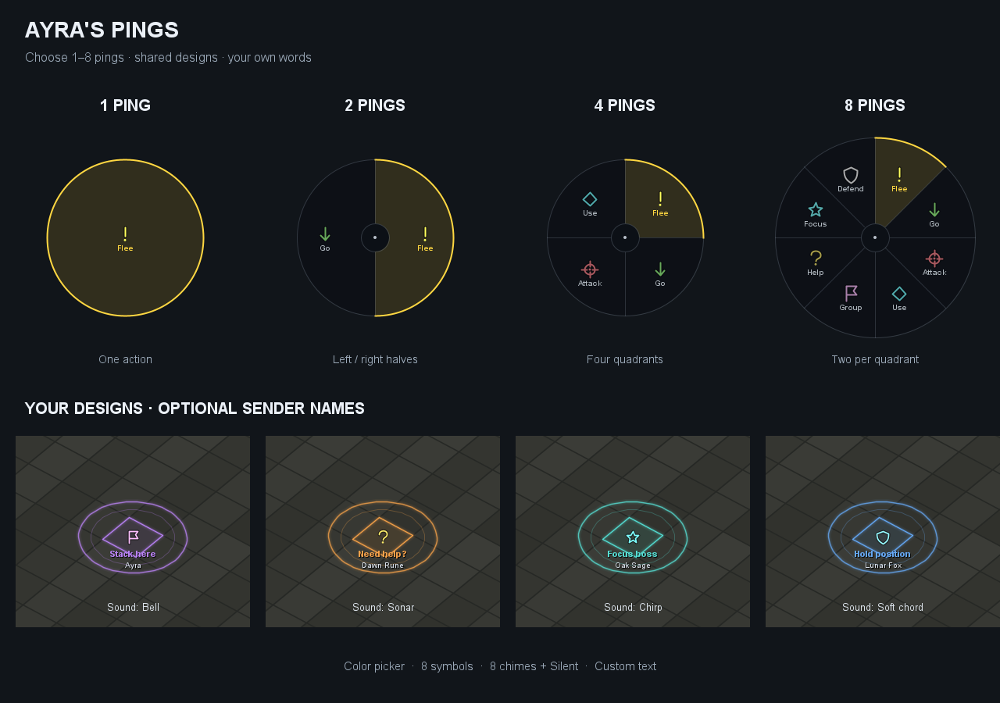
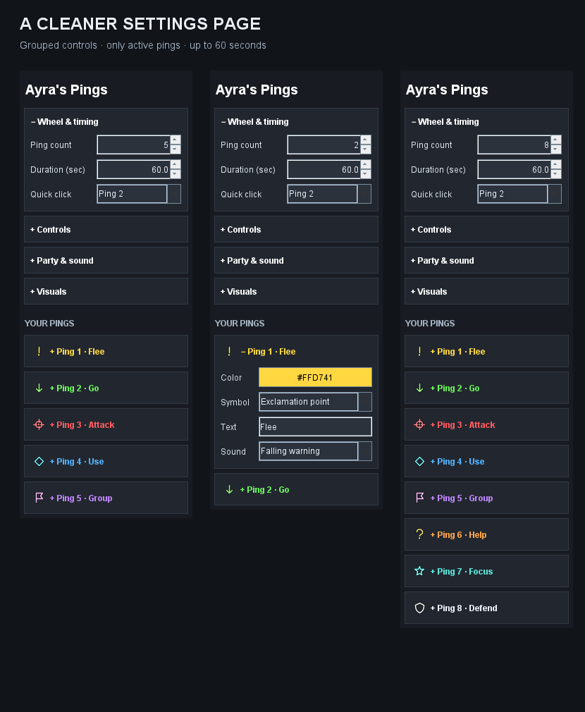

<!-- Copyright (c) 2026, Drew. SPDX-License-Identifier: BSD-2-Clause -->
# Ayra's Pings

Manual, temporary team pings for RuneLite: choose **1–8 wheel slots**, each with a color picker, a symbol and sound from the bundled libraries, and your own text. Pings highlight the clicked tile with a circular ripple that expands, returns and fades.

Click an NPC, player, world object or visible dropped item when pinging and its model border pulses in the ping color, then fades with the ripple. The selected entity is fixed at mouse-down; dragging over something else does not change it. Moving actors keep their outline for that ping's configured lifetime. Despawns, replacement entities and scene changes clear the outline. Ground items must be among the models already rendered in the item pile; hidden/unrendered drops are not revealed. Inventory widgets remain normal inventory clicks.



## Your wheel and designs

Open the **Ayra's Pings settings** sidebar button (the green ripple icon). General settings are grouped into **Wheel & timing**, **Controls**, **Party & sound**, and **Visuals** accordions. The standard plugin settings also group these general controls into accordions.

Set **Ping count** from **1 to 8**. Only enabled slots appear in the sidebar's **Your pings** section, your wheel, the quick-click choices and the ground menu. Five enabled slots means exactly five customization accordions. Reducing the count keeps disabled slots' saved designs so they return when re-enabled. The first four retain the original Flee, Go, Attack and Use defaults.

- **1:** one action in the center.
- **2:** a vertical divider makes right and left halves.
- **4:** horizontal and vertical dividers make four quadrants.
- **8:** two sectors per quadrant. Counts 3, 5, 6 and 7 also use evenly sized sectors.

Slots run clockwise from the top boundary. With four slots, Ping 1 is northeast, Ping 2 southeast, Ping 3 southwest and Ping 4 northwest. **Quick-click ping** chooses the slot sent without dragging; its default is Ping 2 (Go). If that slot is disabled, quick-click uses Ping 1.

Expand an enabled **Ping 1–8** accordion in the sidebar to choose:

- **Color:** RuneLite's RGB color picker. The exact RGB value is shared.
- **Symbol:** exclamation point, arrow, crosshair, diamond, question mark, flag, star or shield.
- **Text:** your own single-line plain Unicode text, up to 64 characters. Leave it empty for no label. Angle brackets are literal text, not formatting commands. Invisible controls are removed locally and rejected in incoming designs. Long wheel labels are shortened visually; the scene label and shared message retain the full text.
- **Sound:** Falling warning, Rising chime, Triple strike, Bright double chime, Bell, Sonar, Chirp, Soft chord, or Silent. All eight original chimes ship with every installation; there are no uploads or runtime downloads.





| Slot | Default color | Default text | Symbol | Chime |
| --- | --- | --- | --- | --- |
| 1 | Yellow | Flee | Exclamation point | Falling warning |
| 2 | Green | Go | Arrow | Rising chime |
| 3 | Red | Attack | Crosshair | Triple strike |
| 4 | Blue | Use | Diamond | Bright double chime |
| 5 | Purple | Group | Flag | Bell |
| 6 | Orange | Help | Question mark | Sonar |
| 7 | Teal | Focus | Star | Chirp |
| 8 | White | Defend | Shield | Soft chord |

## Controls

For mouse-only priming, set **Ping input** to **Mouse button 4** or **Mouse button 5** in Ayra's Pings settings. **Tap the side button to prime one ping**, then **left-click a scene or minimap tile, drag toward an action, and release** to send it. The tile is selected by your left-click. The side button itself never sends a ping. A small **Ping ready: click & drag** hint follows the cursor while primed; it clears when you click. A quick primed left-click sends your **Quick-click ping** (Go by default). Tap the side button again, press Escape, right-click, leave the canvas or lose focus to cancel. Clicking an interface cancels priming and preserves that interface's normal action. The keyboard hotkey is inactive in mouse mode. Your mouse must send a native MB4/MB5 event; if its software remaps the side button to a keyboard key, restore its normal mouse-button assignment.

Hold **Alt**, press the left mouse button on a **scene tile or the visible minimap**, drag toward an action, and release. A quick Alt-click without dragging sends your **Quick-click ping**. The chosen tile stays fixed while you select the action. Escape, right-click, leaving the canvas or losing focus cancels the wheel. The wheel key is configurable. Alt-drag on RuneLite overlay panels can conflict with moving overlays; use the ground or choose a different ping key.

You can also right-click a ground tile and choose an enabled **Ping 1–8** entry with its custom text and color. These entries sit below **Walk here**, preserving ordinary left-click behavior. They only create a ping; they do not walk, attack, use an item, change a target, or send an OSRS game action.

Default lifetime is **1.6 seconds**, configurable from **0.8 to 60 seconds**. The sidebar's **Duration (sec)** field accepts up to 60.0; the standard settings use milliseconds, up to 60,000. Long pings appear promptly, hold their marker, then return and fade at the end. Lifetime is local: each receiving client uses its own duration setting. Sound, independent volume, minimap ripples, scene labels, sharing and receiving can be configured separately. Scene labels default to enabled; an existing saved preference is preserved. Reduced motion replaces the moving ripple with a stationary fading tile and ring. Symbols distinguish actions without relying only on color.

**Sender names** (under **Visuals**) optionally shows who sent each scene ping beneath its symbol/custom text. It defaults to off and works independently of **Scene labels**, so names can remain visible while action text is hidden. Local pings use your in-game display name; received pings use the sender's existing RuneLite Party display name. Unknown names are omitted. Labels identify the sender, not the clicked target, and fade with the ping. This setting is local and adds no name field or new messages to the ping protocol.

**Clicked-target outlines** controls the pulsing border. Reduced motion also makes the target border steady before its final fade. Press-and-drag can begin immediately: target capture and release are queued in order using the saved mouse-down position, with no required hold delay.

This version supports the game scene and minimap, with the local player's top-level world view. The full-screen world-map interface and nested views such as sailing interiors are not input targets. Game-disabled minimaps remain disabled. Markers clear on scene loading, logout, world hop and party changes.

## Sharing with friends

1. Each player installs and enables **Ayra's Pings**.
2. Enable RuneLite's built-in **Party** plugin and create or join the **same party** using its passphrase.
3. Be in the same game world, plane and loaded scene. Leave **Share with party** and **Receive party pings** enabled.
4. Ping a tile. Your own marker and chime appear immediately; other party members receive the same slot and design through RuneLite's party relay.

With **Use shared designs** enabled (the default), clients on 1.2.0 or newer use the sender's color, symbol, text and selected bundled chime. Your wheel size only affects what you can send: you can receive all eight slots even with a one-slot wheel. Disable **Use shared designs** to apply your own matching slot design to incoming pings. Your volume, mute, labels, reduced motion and outline settings always remain yours.

No separate server, port forwarding, API key, or paid service is needed. Normal Party tile pings do not carry these four action meanings; everyone receiving these pings needs this plugin. If Party's own ping hotkey overlaps, change one of the hotkeys in its settings. Ayra's Pings does not alter another plugin's settings, create/join a party, or leave a party when disabled. Local pings also work without a party. A dropped relay connection can prevent delivery; the plugin does not claim acknowledgements or guaranteed delivery.

Sharing sends the clicked tile, its template coordinates and instance flag, world, original action, slot number, RGB color, library symbol/sound names, custom text, random ping identifier, protocol version and timestamp. Custom text is sent only when you deliberately ping. A deliberately selected target adds its kind, NPC/object/item ID or actor index; a selected player also includes that player's normalized name to prevent highlighting a different player at a reused index. RuneLite's relay attaches its existing party member identifier. This plugin adds no account credentials, chat contents, gear or background player-location stream. Disable **Share with party** for local-only sending, or **Receive party pings** to ignore incoming pings. RuneLite's Party plugin has its own independent data sharing. Protocol-1 compatibility is preserved: older clients show the original Flee/Go/Attack/Use design for slots 1–4, and a standard Go ping for slots 5–8. Both clients need 1.2.0 or newer for shared customization, and 1.1.0 or newer for shared target outlines. Incoming legacy pings use the original action design. Missing, malformed or unknown library designs fall back to the original action without downloading assets.

Incoming messages are restricted to current party members and matching world, plane, physical scene coordinates and template coordinates. Instance pings are not broadly remapped to every repeated room with the same template. Invalid, stale and duplicate messages are ignored. Sender clocks need to be reasonably synchronized (10 seconds behind / 30 seconds ahead tolerance). Rate limits allow one accepted ping per sender per 450 ms and one overall per 120 ms, with bounded history and active markers. Extra pings are dropped to limit visual and audio spam.

## Build and local testing

Use JDK 11 or newer (development checks used JDK 17). The wrapper verifies the Gradle distribution checksum. RuneLite dependencies default to `latest.release`, as recommended by the official template.

```powershell
.\gradlew.bat test jar
.\gradlew.bat preview
.\gradlew.bat run
```

`run` starts standard RuneLite in developer mode with this plugin registered. Enable **Ayra's Pings** in its settings. `preview` renders the actual Java painter onto a synthetic floor, producing `build/previews/renderer.png`. No login is needed for the automated tests or preview.

The plugin JAR is `build/libs/tactical-pings-1.4.0.jar`. A compatible client's existing sideload loader can load this JAR; standard RuneLite Plugin Hub distribution follows the source-review process below. For a client on a known older API, build and test with a quoted override, for example:

```powershell
.\gradlew.bat test jar '-PruneliteVersion=1.13.7'
```

All eight WAVs are bundled classpath resources. Their original synthesis source is in `tools/GenerateChimes.java`; regenerate them with `java tools/GenerateChimes.java` from this directory. This offline authoring tool is excluded from the plugin JAR. Audio playback uses RuneLite's injected `AudioPlayer` and executor, away from the game thread.

## Submission

This is the standalone source repository for **Ayra's Pings**. See [SUBMISSION.md](SUBMISSION.md) for the review notes and validation. Plugin Hub submissions reference this repository and a specific source commit in a single manifest in **runelite/plugin-hub**.

The overlay uses Java2D paths and original bundled chimes. The documentation preview is an offline render on a synthetic floor. No RuneScape screenshots or generated concept artwork are included in the plugin. Code, icon and chimes are BSD-2-Clause.
